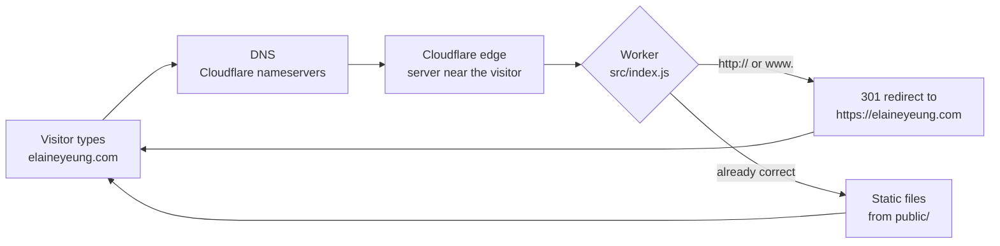
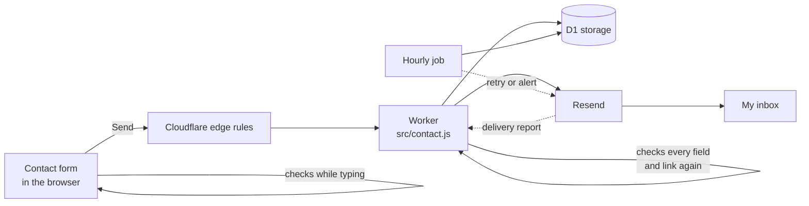

# How elaineyeung.com works

This guide explains how each part of the site works and why it was built this way. Technical terms are defined in the glossary at the end.

In short: when someone visits elaineyeung.com, their request goes to Cloudflare, a global network with servers close to every visitor. A small program there makes sure everyone lands on the one secure (HTTPS) address and sends back the website files. When a visitor uses the contact form, the same program checks the message, stores it privately, and emails it to me.

Security specifics (exact limits, screening rules, and keys) are intentionally left out of this guide.

## 1. What happens when someone visits

1. **DNS lookup.** The browser asks "where is elaineyeung.com?" The domain's nameservers point to Cloudflare, so Cloudflare answers.
2. **Nearest edge server.** The visitor connects to a nearby Cloudflare data center, which also handles HTTPS with an auto-renewing certificate.
3. **The Worker runs first.** Before any file is sent, `src/index.js` checks the address. `http://` and `www.` requests get a **301 redirect** to `https://elaineyeung.com`; everything else is served from `public/`.
4. **Security headers** are added to every response (see section 4).

## 2. What happens when someone sends a message

1. **The form opens only when asked.** The "Contact Me" buttons open a pop-up; closing it before sending erases what was typed. Nothing is stored in the browser.
2. **Instant feedback.** As the visitor types, the browser checks required fields, email format, the word limit, and the basic shape of every link. Links are rewritten to `https://`. All problems are shown at once, each under its own field.
3. **Edge rules.** Before a submission reaches the code, Cloudflare only accepts genuine form submissions from this site and blocks bursts of requests.
4. **Server checks.** The Worker repeats every browser check (`public/form-check.js`, shared by both sides), verifies the bot check, applies per-visitor limits, and screens every link against private lists and Google Safe Browsing. Error messages say which field or link to fix, never why a link was refused.
5. **Repeats.** Re-sending an identical form within a short window isn't stored twice; the visitor is told it was already received. Switching on the resume request makes it a new message.
6. **Storage, then delivery.** The message is saved in D1 first, then emailed through Resend, with the visitor's address as the reply-to. The visitor sees "received" once it's safely saved.
7. **Confirmation.** Resend's signed delivery report tells the Worker the email arrived, and the stored copy is deleted.
8. **Hourly job.** Retries anything unsent, removes old records, and emails me a short alert (no visitor details) if anything has been waiting too long, at most once a day.
9. **Link list reviews.** A scheduled review periodically suggests updates to the private link screening lists and saves them beside the live lists. The hourly job emails me when a new suggestion is waiting; nothing changes on the live site until I review and approve it.

## 3. File-by-file guide

### Settings

| File | What it holds |
|---|---|
| `wrangler.example.jsonc` | Template of the Cloudflare settings. The real `wrangler.jsonc` (with account resource IDs) is kept out of the repository. |
| `.dev.vars` | Local preview settings and test keys; never committed |
| Cloudflare secrets | Private live settings, set with `npx wrangler secret put <NAME>` |

Settings the Worker reads (values are private):

| Name | Kind | Purpose |
|---|---|---|
| `SITE_ORIGIN`, `TIME_ZONE`, `SUBJECT_PREFIX`, `TURNSTILE_SITE_KEY` | Public variable | Site address, time zone for email timestamps, email subject prefix, bot check's public key |
| `TURNSTILE_SECRET_KEY` | Secret | Verifies the bot check |
| `RESEND_API_KEY`, `MAIL_FROM` | Secret | Sending email (the key can only send, from one domain) |
| `RESEND_WEBHOOK_SECRET` | Secret | Verifies delivery reports |
| `CONTACT_TO`, `ALERT_TO` | Secret | Where messages and alerts go |
| `IP_HASH_SALT` | Secret | Makes stored visitor-address hashes irreversible |
| `CONTACT_MAX_PER_HOUR`, `CONTACT_MAX_REFUSED_PER_HOUR`, and similar | Secret | Abuse limits |
| `SAFE_BROWSING_KEY` | Secret | Google Safe Browsing lookups |
| `DB` (D1), `LINK_RULES_KV` (KV) | Binding | Message storage and the private link screening lists |

If a required setting is missing, the form refuses to run rather than running with weaker protection.

### `src/` (the Worker)

| File | Job |
|---|---|
| `index.js` | Redirects, security headers, routing to the form, filling in the bot check's public key, and starting the hourly job |
| `contact.js` | Receives, checks, stores, and sends form messages; handles delivery reports and the hourly job |
| `link-screening.js` | Server-only link screening against the private lists in KV |
| `email.js` | Sends email through Resend and verifies the signature on delivery reports |

### `public/` (sent to the browser)

| File | Job |
|---|---|
| `index.html` | The page, the contact pop-up, and the "couldn't be sent right now" pop-up. Kept off GitHub because it holds my work history; the repository has `public-index/index.html`, the same page with those sections left out, built by `npm run public-index`. |
| `styles.css` | Design, light/dark themes, responsive layout |
| `script.js` | Menu, theme switch, typing titles, scroll animations |
| `contact-form.js` | Opening and closing the form, the discard prompt, instant checks, sending |
| `form-check.js`, `form-rules.js`, `links.js` | Checks and general limits shared with the Worker, so both report problems identically |
| `.well-known/security.txt` | How to report a security issue (points to the form) |

### Other folders

| Folder | Contents |
|---|---|
| `migrations/` | D1 table definitions, applied with `wrangler d1 migrations apply` |
| `test/` | Unit tests, run with `npm test` |
| `scripts/` | `public-index.mjs`, which builds the GitHub copy of the page |

## 4. Security headers

Every response leaves through `withSecurityHeaders()` in `src/index.js`, which adds a Content Security Policy, HSTS, `X-Content-Type-Options`, `X-Frame-Options`, `Referrer-Policy`, `Permissions-Policy`, and `Cross-Origin-Opener-Policy`. The policy allows only the site's own files, Google Fonts, Cloudflare's analytics and bot check, and one inline script identified by its SHA-256 hash, so editing that script means updating the hash.

## 5. Design decisions

The main decisions and the reasoning behind each are listed under **[Key design decisions](../README.md#key-design-decisions)** in the README. A few implementation choices:

- **Workers with static assets instead of Cloudflare Pages.** *Why:* a Worker can run logic (redirects, the form's server side) in front of every request.
- **One set of checks for the browser and the server.** *Why:* visitors see exactly the problems the server would report, and the two can't drift apart.
- **Store first, then send.** *Why:* if email delivery fails, the message is still safe and is retried.
- **The sending service has its own subdomain.** *Why:* even if its key leaked, it couldn't send as my personal professional address.

## 6. Glossary

| Term | Meaning |
|---|---|
| **DNS** | The internet's address book: turns `elaineyeung.com` into server addresses |
| **TLS / HTTPS** | Encryption between the browser and the server (the padlock icon) |
| **301 redirect** | "This moved permanently, go here instead" |
| **Edge** | Servers spread around the world, close to visitors |
| **Worker** | A small program that runs on Cloudflare's edge for each request |
| **D1** | Cloudflare's SQL database |
| **KV** | Cloudflare's key-value storage |
| **Turnstile** | Cloudflare's bot check, usually invisible to people |
| **Secret** | A private setting stored by the hosting platform instead of in the code |
| **Salted hash** | A one-way scramble of a value mixed with a secret, so the original can't be recovered |
| **Content Security Policy** | A header listing exactly which scripts, styles, and fonts a browser may load |
| **HSTS** | A header telling browsers to always use HTTPS for this site |
| **security.txt** | A standard file telling security researchers how to report problems |
