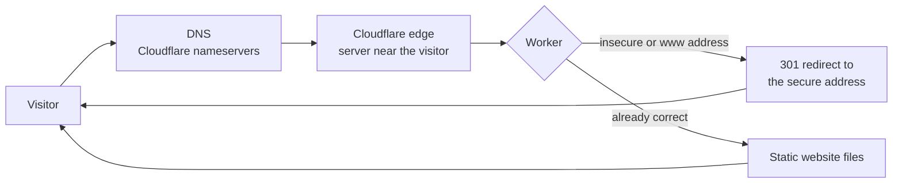
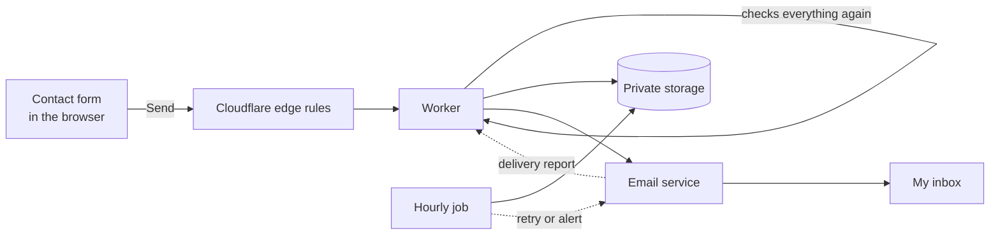

# How the site works

A short overview of the architecture. Security specifics (limits, screening methods, settings, and keys) are intentionally left out.

In short: when someone visits the site, their request goes to Cloudflare, a global network with servers close to every visitor. A small program there (a "Worker") makes sure everyone lands on the one secure (HTTPS) address, adds browser protections, and sends back the website files. When a visitor uses the contact form, the same program checks the message, stores it privately, and emails it to me.

## 1. What happens when someone visits

1. **DNS and the nearest server.** The domain's nameservers point to Cloudflare, so the visitor connects to a nearby data center that also handles HTTPS with an auto-renewing certificate.
2. **The Worker runs first.** Before any file is sent, it checks the address, redirects insecure or `www.` requests with a permanent (301) redirect, and adds browser protections to every response.
3. **Static files.** Everything else is served as plain HTML, CSS, and JavaScript, with no frameworks and no build step.

## 2. What happens when someone sends a message

1. **Instant feedback.** As the visitor types, the browser checks the fields and links and reports every problem at once, each next to its field.
2. **Layered protection.** Cloudflare's edge rules and a bot check come first. The Worker then repeats every browser check, applies limits, and screens links, so skipping the page gets around nothing.
3. **Store first, then send.** The message is saved privately before it's emailed, so a failed send is never lost. A signed delivery report confirms arrival, and the stored copy is then deleted.
4. **An hourly job.** It retries anything unsent, tidies old records, and alerts me if something is stuck. It also sends me a short reminder when a tool update is ready, and when a scheduled review has suggestions for the private link lists. Nothing changes on the live site without my approval.

## 3. Folders

| Folder | Contents |
|---|---|
| `public/` | The site's styles and scripts, including the form's browser-side checks (the page itself is kept private) |
| `src/` | The Worker: routing, the contact form, link screening, and email |
| `migrations/` | Database table definitions |
| `test/` | Unit tests, run with `npm test` |
| `docs/` | This overview |

Private settings (keys, addresses, limits, and the wording of my alert emails) are Cloudflare secrets, never files in this repository. If a required setting is missing, the form refuses to run rather than running with weaker protection.

## 4. Design decisions

The main decisions and the reasoning behind each are in the README's **Key design decisions**. A few implementation choices:

- **Workers with static assets instead of Cloudflare Pages.** *Why:* a Worker can run logic (redirects, the form's server side) in front of every request.
- **One set of checks for the browser and the server.** *Why:* visitors see exactly the problems the server would report, and the two can't drift apart.
- **Store first, then send.** *Why:* if email delivery fails, the message is still safe and is retried.
- **The sending service has its own subdomain.** *Why:* even if its key leaked, it couldn't send as my personal professional address.
- **A person approves every public change and every list update.** *Why:* automation suggests and alerts, and I decide.

## 5. Glossary

| Term | Meaning |
|---|---|
| **DNS** | The internet's address book |
| **HTTPS** | Encryption between the browser and the server (the padlock icon) |
| **301 redirect** | "This moved permanently, go here instead" |
| **Edge** | Servers spread around the world, close to visitors |
| **Worker** | A small program that runs on Cloudflare's edge for each request |
| **D1 / KV** | Cloudflare's database and key-value storage |
| **Turnstile** | Cloudflare's bot check, usually invisible to people |
| **Secret** | A private setting stored by the hosting platform instead of in the code |
